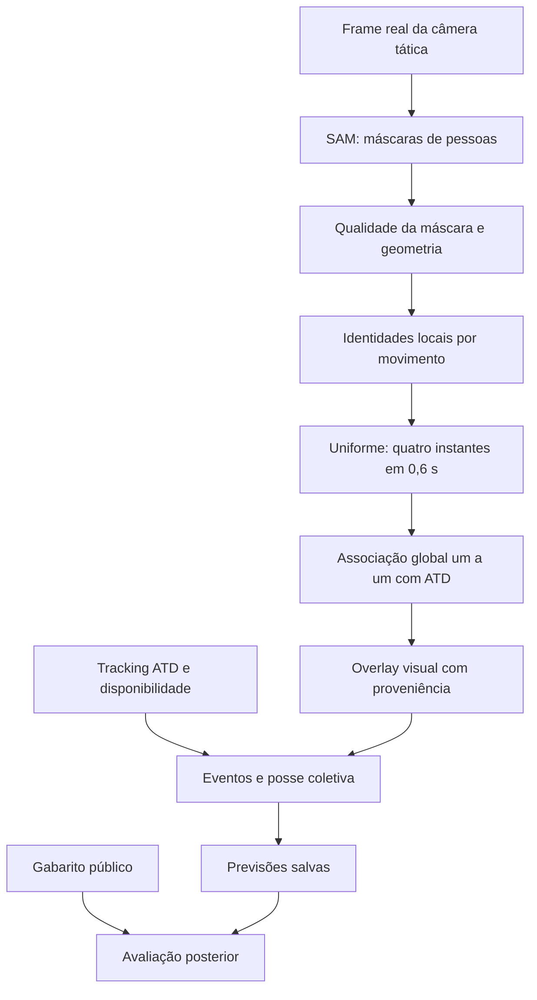

# Implementações — material para revisão dos mentores

**Retrato do projeto em 16/11/2026.** Este documento descreve código existente e resultados locais já produzidos. As hipóteses de evolução, riscos e decisões em aberto estão em [Desafios e pontos de definição](DESAFIOS-E-PONTOS-DE-DEFINICAO.md). O objetivo é permitir revisão técnica sem precisar reconstruir o histórico das conversas.

## 1. Objetivo e situação atual

O problema final é estimar a posse de bola por equipe em cada frame e reconstruir sequências de posse coerentes. O projeto usa tracking ATD, eventos e, experimentalmente, imagens da câmera tática para corrigir a identificação das pessoas. A saída tem quatro estados: **H** (Barcelona neste jogo), **A** (Athletic), **D** (bola morta) e **X** (desconhecido).

Há dois problemas distintos: reconhecer o uniforme e decidir posse. Um uniforme corretamente identificado não demonstra controle da bola nem que o jogo esteja em andamento. A avaliação oficial também considera macroF1 e spellF1; acurácia por frame sozinha não resume a qualidade de posse. Ver [avaliação oficial](EVALUATION.md).

| Componente | Estado concreto | Evidência / limite |
|---|---|---|
| Leitura ATD, contrato e eventos de controle | Implementado | Testes de causalidade, disponibilidade e continuidade |
| Posse coletiva, passes e contexto temporal | Implementado e avaliado em trecho público | Resultados locais de 120 s; não validação dos 90 min |
| Evidência visual revisada de goleiro e paralisação | Implementada em vias separadas | Algumas cenas reais; revisão humana explícita |
| Classificador supervisionado de uniformes | Implementado e congelado em v4 | Exemplares de cor, não ajuste de rede neural |
| Fusão de quatro frames em 0,6 s | Implementada como padrão supervisionado | Comparação em 29 sequências avaliadas |
| SAM → geometria → identidade → ATD → posse | Integrado no código | Nova execução de posse completa ainda não terminou |
| Otimização espacial das máscaras | Implementada | Equivalência em 20 frames reais e testes automatizados |
| Detector leve com SAM apenas em casos difíceis | **Proposto, não implementado** | Escolha de modelo e critérios aguardam revisão |

A inferência longa foi pausada para investigar desempenho. Não há processamento visual completo da partida nem nova acurácia de posse com a política de 0,6 s.

## 2. Dados, alinhamento e reprodução causal

- Fonte principal: tracking e vídeo **tactical**, com homografia para relacionar campo e imagem. Broadcast tem outra timeline e não é substituído silenciosamente.
- Convenção do projeto: `video_frame = ATD_frame_id − 1`, preservando a timeline original de 25 fps.
- Cada observação distingue o instante do evento de sua disponibilidade (`available_at_frame`). Evidência atrasada não reescreve previsões antigas.
- O gabarito público é usado para avaliação depois de gerar as previsões; não é entrada dos classificadores ou da posse.
- Frames ausentes, ambiguidades e posições indisponíveis são registrados. Não se cria bola ou atleta para completar a animação.
- Dados de jogo e artefatos locais ficam fora do Git. O repositório publica código, testes, documentação e o gabarito público autorizado, conforme [licença](../LICENSE) e [dados](DATA.md).

Fluxo de alto nível:



O diagrama mostra o caminho supervisionado atual. Existe também um caminho legado com referências de máscaras, preservado para comparação.

## 3. Tracking, eventos e posse coletiva

### Controle e bola ausente

O detector verifica proximidade, movimento, persistência, cobertura, duplicatas e saltos. O consumidor de posse separa aquisição, perda e ausência de bola. Na configuração experimental de comparação, aquisição e perda usam três frames; a tolerância curta de bola ausente é de cinco frames e não é a mesma janela da classificação de uniforme.

Expirar essa tolerância impede que uma posse antiga permaneça válida indefinidamente. Um passe previsto não autoriza criar uma observação de bola. O código conserva suporte temporal e motivos para cada decisão.

### Hipóteses de passe e recepção

A posse coletiva usa contexto de movimento, trajetória local da bola, origem do passe, oportunidades de encontro e recepção provável sustentada. Os parâmetros são hipóteses físicas explícitas, não probabilidades calibradas. A configuração atual inclui contexto de 25 frames, cinco recentes, horizonte de previsão de 2 s e restrições de recepção sustentada.

Kickoffs e descontinuidades reiniciam o contexto relevante. As marcações de início de tempo são tratadas separadamente de aquisição individual. Uma previsão de chegada adversária não é, sozinha, controle confirmado.

### Evidências visuais e paralisações

Há vias explícitas para controle visual revisado, recuperação de observações e estado do jogo. Bola nas mãos de goleiro revisada por pessoa não é apresentada como detecção automática. Árbitros e pessoas externas não se tornam candidatos de equipe. Reconhecer um goleiro não gera automaticamente posse ou bola em jogo.

Implementações principais: [motor coletivo](../src/team_possession/collective.py), [contrato e detector](../src/ball_events/), [posse coletiva](POSSE-COLETIVA.md) e [catálogo de métricas](METRICAS-POSSE-COLETIVA.md). Esses guias preservam etapas históricas; este documento e o código atual delimitam o estado da entrega.

## 4. Identificação supervisionada de uniformes

### Algoritmo e base local

O classificador v4 usa um descritor HSV de 200 dimensões do tronco: 192 componentes de tonalidade/saturação e oito de luminosidade. Compara a distância de Hellinger com os exemplares de cada classe e retém a menor distância por classe. Não houve treinamento ou ajuste fino de uma rede neural de uniformes.

O modelo contém **167 recortes de treino**, distribuídos assim:

| Classe | Recortes |
|---|---:|
| Barcelona | 58 |
| Athletic | 65 |
| Arbitragem | 17 |
| Goleiro Barcelona | 11 |
| Goleiro Athletic | 15 |
| Outro | 1 |

`Incerto` é uma abstenção, não uma classe aprendida por exemplar. A classe Outro tem somente um exemplo e não valida rejeição geral de pessoas externas.

Dos 167 recortes, **64 vêm de 16 sequências**, com quatro frames por sequência. São correlacionados e não equivalem a 64 exemplos independentes. Os demais recortes também não comprovam independência por pessoa ou trecho. Alguns testes antigos foram promovidos a treino por autorização explícita; esses testes deixam de ser independentes das versões posteriores.

Os limites foram mantidos: distância máxima **0,35** e margem mínima **0,10** entre as duas melhores classes. Os novos rótulos da rodada 11 não foram incorporados ao treino.

### Política temporal escolhida

A política `supervised-four-spaced-frames-0.6s-v1` usa offsets **[-15, -10, -5, 0]**, relativos ao frame atual na timeline de 25 fps. O intervalo entre a primeira e a última amostra é de **0,6 s**.

- A identidade deve permanecer acompanhada nos **16 frames consecutivos** do intervalo; amostragem espaçada não significa ignorar perdas intermediárias.
- As distâncias por classe são combinadas pela mediana.
- São necessários ao menos três descritores válidos e três apoios à classe vencedora entre as quatro amostras previstas. O apoio é a classe de menor distância individual, antes dos limiares finais.
- Distância e margem agregadas ainda precisam passar pelos limites congelados.
- Lacuna, identidade nova ou associação duvidosa reiniciam o histórico. Não há uso de frames futuros.
- O fluxo mantém scores/descritivos das observações anteriores, sem guardar todas as imagens RGB. O aquecimento mínimo é de 0,6 s; tempo computacional é outra medida.

A política anterior, de quatro frames consecutivos e 0,12 s, permanece disponível por opção explícita. O novo fluxo em execução foi conferido contra as previsões congeladas das quatro amostras espaçadas: os 32 casos reproduziram suas classes e, quando disponíveis, as distâncias agregadas.

Código: [classificador](../src/team_identification/supervised_uniforms.py), [política escolhida](../src/team_identification/spaced_frames.py), [combinação experimental](../src/team_identification/temporal_windows.py) e [executor](../scripts/run_team_identity.py).

## 5. Associação, geometria e integração

A pessoa é associada por identidade local construída com geometria e movimento; o número do slot ATD não é identidade permanente. O pareamento pessoa–ATD é global e um a um, com limites de distância e margem para alternativas. Ambiguidades não são convertidas em atletas duplicados.

No caminho atual com SAM, os pés são estimados a partir da região inferior da máscara e projetados pela homografia. Trata-se de estimativa automática, não de posição revisada manualmente. Máscara fundida, geometria inválida ou identidade instável podem impedir a classificação ou a integração.

O overlay mantém frame, identidade, associação, time, papel, suporte, disponibilidade e hashes. Posse e desenho consomem as mesmas observações corrigidas. Pessoas com posição mas sem equipe aceita aparecem neutras; posições ausentes não são inventadas. Entrada e saída da janela corrigida reiniciam memória para evitar carregar decisões de slots antigos.

Código: [pipeline](../src/team_identification/pipeline.py), [associação](../src/team_identification/association.py), [overlay](../src/team_identification/overlay.py) e [desenho](../src/team_identification/render.py).

## 6. Experimento de janelas: protocolo e resultados

As quatro configurações utilizaram o mesmo modelo congelado, os mesmos atletas e o mesmo instante final. As previsões foram salvas **antes dos rótulos de equipe do usuário**. Houve revisão visual da continuidade, inclusive nos frames intermediários; propostas com perda de identidade foram omitidas, sem preencher a lacuna com outra pessoa.

Foram preparados 32 casos em três grupos temporais: finais **145000, 160000 e 180000**. Cada caso tinha uma janela de 51 frames reais para verificar os dois segundos da configuração mais longa. Os trechos foram conferidos contra os pools de treino, os exemplos efetivamente presentes no modelo e os registros históricos. A margem exigida foi de 750 frames sobre a janela completa; as menores distâncias históricas registradas nos três grupos foram 9.947, 24.947 e 44.947 frames.

O usuário forneceu 31 rótulos visuais. Os casos **173, 174 e 175 foram excluídos por solicitação explícita**; 175 foi excluído sem classe atribuída. As exclusões ocorreram depois da rotulagem e foram aplicadas igualmente às quatro configurações. Restaram **29 unidades de avaliação por sequência**, não uma avaliação por frame.

| Configuração | Offsets | Acertos | Abstenções | Classes aceitas erradas | Cobertura | Acurácia dos aceitos |
|---|---|---:|---:|---:|---:|---:|
| 4 consecutivos, 0,12 s | -3, -2, -1, 0 | 23/29 | 6 | 0 | 79,3% | 100% |
| **4 espaçados, 0,6 s** | **-15, -10, -5, 0** | **26/29** | **3** | **0** | **89,7%** | **100%** |
| 8 em 1 s | -25, -21, -18, -14, -11, -7, -4, 0 | 25/29 | 4 | 0 | 86,2% | 100% |
| 12 em 2 s | -50, -45, -41, -36, -32, -27, -23, -18, -14, -9, -5, 0 | 24/29 | 5 | 0 | 82,8% | 100% |

Cobertura = respostas aceitas / casos avaliados. Acurácia dos aceitos = acertos / respostas aceitas. A taxa de acerto sobre todos os casos também é 89,7% para 0,6 s porque não houve erro aceito nessa amostra. Isso não demonstra acurácia populacional de 100%.

| Categoria | Casos | Acertos 0,12 s | Acertos 0,6 s | Acertos 1 s | Acertos 2 s |
|---|---:|---:|---:|---:|---:|
| Barcelona | 10 | 7 | 9 | 8 | 8 |
| Athletic | 11 | 11 | 11 | 11 | 10 |
| Arbitragem | 5 | 4 | 5 | 5 | 5 |
| Goleiro Barcelona | 2 | 1 | 1 | 1 | 1 |
| Goleiro Athletic | 1 | 0 | 0 | 0 | 0 |

As respostas restantes são abstenções. Outro não teve caso avaliável. Em relação a 0,12 s, a janela de 0,6 s resolveu os casos 162, 172 e 179, sem piora observada; 1 s resolveu 162 e 172. A janela de 2 s resolveu 162, 172 e 179, mas passou de acerto a abstenção em 160 e 161. A política de 0,6 s foi escolhida pelo usuário após observar essa comparação; é uma escolha exploratória sobre esse teste, não uma validação independente da política selecionada.

Não se concluiu ganho apenas pela redução de Incerto: foram conferidos os rótulos das novas respostas aceitas, e não houve atribuição errada observada. Ainda assim, os casos compartilham apenas três trechos, há poucos goleiros, sombra forte foi pouco representada e a revisão manual de recortes não valida a detecção automática.

## 7. Acurácia de posse: resultado anterior e medição pendente

O resultado anterior salvo em `collective-context25-goalkeeper-v5` foi medido no trecho público tactical **11185–14184**, 3.000 frames, 25 fps, 120 s:

| Execução daquele comparativo | Acurácia por frame | macroF1 | spell_f1_mean |
|---|---:|---:|---:|
| Comparador anterior (v4) | 72,17% | 0,6527 | 0,4870 |
| Contexto 25 + goleiro | **73,27%** | **0,6778** | **0,5524** |

Esses números são da execução histórica, anterior à avaliação completa com o novo overlay de equipes. Não são resultado da política de quatro frames em 0,6 s. O gabarito é o público oficial fornecido para a competição; não se atribui esse resultado a um modelo proprietário do Barcelona.

A nova cadeia de identificação → overlay → posse → avaliação foi iniciada, mas pausada durante a análise visual. O executor de medição dependente também está parado. **Nova acurácia de posse: pendente. Nova animação completa com essa política: não produzida.** Não há execução automática em andamento para terminar esses dois minutos neste estado da entrega.

## 8. Desempenho: mudança implementada e alcance da evidência

A auditoria foi feita no Mac disponível: **Apple M1, 16 GB**. Foram removidos cálculos redundantes de sobreposição, restringidas interseções/erosão às caixas reais e compartilhada a conversão RGB. Máscaras booleanas não repetem a verificação de valores numéricos. O tratamento de bordas mantém equivalência com a máscara inteira; a saída de máscara, quando solicitada, conserva o tamanho original.

| Medida | Resultado | Escopo da evidência |
|---|---:|---|
| Etapa CPU antes | 2,025 s/frame | 20 frames reais consecutivos |
| Etapa CPU depois | 0,561 s/frame | Mesmas imagens, máscaras, tracking e modelo |
| Ganho dessa etapa | **3,61×** | Saídas completas idênticas nos 20 frames |
| SAM completo | **9,068 s/frame em média** | Dois frames reais, outro teste por etapas |
| Execução completa acelerada | **Não medida** | Ganho de 3,61× não vale para toda a cadeia |

O teste de SAM separou codificação da imagem, texto/detecção e cópia das máscaras; não inclui toda a decodificação, geometria, gravação ou posse. Uma soma ilustrativa dessas medições sugere aproximadamente 1,15× no total, mas não substitui um benchmark completo. Uma tentativa de precisão reduzida não mostrou ganho consistente e não foi habilitada.

A equivalência dos 20 frames usa máscaras já salvas: isola a otimização CPU e não revalida a detecção SAM. A versão otimizada mantém o modelo de uniformes, seus limiares e a política temporal. Ver [otimizações](../src/team_identification/pilot.py) e [testes específicos](../tests/test_identity_performance.py).

## 9. O que um mentor consegue reproduzir

### Sem dados privados

Na raiz de um clone, com um Python compatível e ambiente virtual próprio:

```sh
python3 -m venv .venv
.venv/bin/python -m pip install -r requirements-dev.txt -r requirements-visual.txt
.venv/bin/python -m unittest discover -s tests -q
```

O ambiente leve local foi verificado com Python 3.14.6. A suíte passou com **322 testes** no estado entregue. Ela exercita contratos, causalidade, associação, abstenções, integração de posse e regressões; não equivale a 322 cenas reais nem comprova precisão na partida. Os testes não precisam carregar o checkpoint de 3,2 GB ou executar a inferência pesada da partida.

Essa execução foi verificada em macOS. Alguns geradores de pranchas e um teste de integração usam o caminho da fonte Arial do sistema Mac; a suíte completa ainda não foi validada em Linux/Windows. Esses ambientes podem exigir adaptação de fontes antes de reproduzir as pranchas. Não se afirma portabilidade integral a partir do teste local.

Há duas famílias de ambiente: o leve para avaliação e testes, e o Python 3.12 ARM64 do SAM com PyTorch/torchvision e o adaptador Mac. As dependências do segundo estão em `requirements-sam3-mac.lock.txt`; elas não devem substituir indiscriminadamente o ambiente leve. O checkout SAM é fixado e verificado pelo adaptador; preparar esse ambiente exige seguir [o guia visual](IDENTIFICACAO-EQUIPES.md) e [o piloto SAM](PILOTO-SAM3.md).

### Com acesso autorizado aos artefatos locais

O modelo congelado está em `outputs/uniform-supervised-model-v4-four-frames/model.json`. Ele e as imagens de treino não são distribuídos neste repositório. Um clone sozinho não reproduz os números reais de uniformes. Os dados licenciados da partida, o checkpoint SAM e os manifestos locais também precisam ser materializados separadamente, sem substituir fontes por imagens sintéticas.

A comparação de janelas segue `prepare → review → predict → respostas do usuário → score` em [compare_uniform_windows](../scripts/compare_uniform_windows.py). Há modelos de resposta gerados pelo próprio preparador. Um destino deve ser novo em cada etapa; não reutilizar a rodada 11 como novo teste independente nem retreinar sem autorização.

Com os artefatos existentes, é possível recomputar a avaliação salva sem executar SAM:

```sh
.venv/bin/python -m scripts.compare_uniform_windows score \
  --predictions outputs/uniform-temporal-round11-predictions/predictions.json \
  --answers outputs/uniform-temporal-round11-user-labels/answers-final.json \
  --out outputs/uniform-temporal-round11-score-reproduzido
```

O fluxo completo de vídeo está em [run_team_identity](../scripts/run_team_identity.py), com padrão de 0,6 s. Sua saída alimenta [run_collective_experiment](../scripts/run_collective_experiment.py) pelo argumento `--team-identity`. A animação usa [render_public_comparison](../scripts/render_public_comparison.py). Nenhum desses passos implica que a execução longa já foi concluída.

### Proveniência dos resultados transcritos

Os arquivos abaixo são **locais e ignorados pelo Git**. Seus hashes identificam os snapshots usados para esta documentação, mas não substituem acesso aos arquivos ou auditoria externa. Os números foram transcritos dos relatórios existentes, sem nova seleção de parâmetros.

| Artefato local | SHA256 |
|---|---|
| Modelo supervisionado v4 (`model.json`) | `a81703e3e525e15ae5dbb283fce744f7111c52ea9aa47513777174c077b19253` |
| Avaliação final da rodada 11 (`comparison.json`) | `0869f8a59904f5d3431d15b2103cd363b85f355446cc1fe9931378155e73c4a3` |
| Posse anterior (`collective-context25-goalkeeper-v5/summary.json`) | `bbe6689692e7874ce8eaff706a484eb7b78619705e81dd9507eef8a1e14f789f` |

Detalhes históricos e comandos adicionais estão em [Identificação de equipes](IDENTIFICACAO-EQUIPES.md). A lista de decisões que gostaríamos de discutir está no [documento de desafios](DESAFIOS-E-PONTOS-DE-DEFINICAO.md).
